<h1 align="center">
  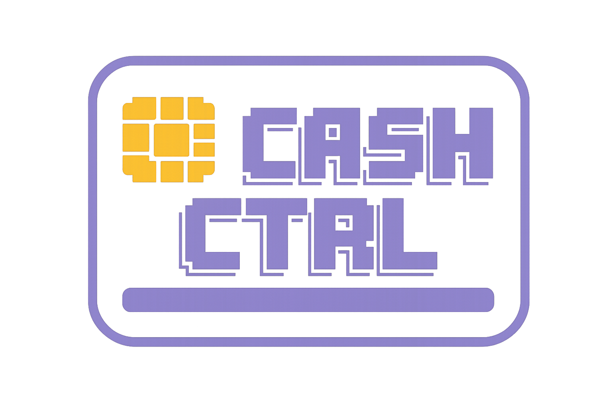
  <br>
  CASH-CTRL
</h1>

<h3 align="center"> 
    Command-line finance control software
</h3>

<p align="center">
  
  
  
  
  
  
</p>

---

## Overview

**Cash-Ctrl** is a minimalist TUI (Terminal User Interface) application for tracking personal expenses and income, stored as structured JSON files called *controls*.

Each control represents a financial period (e.g., "June 2026") and holds a starting balance, expenses, and incomes. The app runs fully in the terminal with a clean purple-on-black aesthetic.

---

## Installation

### Option 1 — Standalone installer (recommended)

Run this single PowerShell command to download `cash-ctrl-installer.exe` from the [latest release](https://github.com/F4NT0/Cash-Ctrl/releases/latest) and start it in the terminal:

```powershell
$f="$env:TEMP\cash-ctrl-installer.exe"; iwr https://github.com/F4NT0/Cash-Ctrl/releases/latest/download/cash-ctrl-installer.exe -OutFile $f; & $f
```

You can also download `cash-ctrl-installer.exe` manually and run it. A Spectre.Console TUI shows the plan and the status of each step:

1. Check for an existing installation (asks whether to delete the old version and install the new one)
2. Fetch the latest release from GitHub
3. Download `cash-ctrl.exe` with a progress bar
4. Install to `%LOCALAPPDATA%\CashCtrl`
5. Add the install directory to the user PATH
6. Verify the installation

Build it from source with `dotnet publish CashCtrl.Installer -c Release -o dist`.

### Option 2 — Built-in TUI installer

Download `cash-ctrl.exe` from the [release page](https://github.com/F4NT0/Cash-Ctrl/releases/latest), place it anywhere, then run:

```powershell
.\cash-ctrl.exe --install
```

The TUI installer will:
1. Let you choose the install directory (default: `%LOCALAPPDATA%\CashCtrl`)
2. Copy `cash-ctrl.exe` to that directory.
3. Add the directory to your **user PATH** automatically.

Open a new terminal and you can use `cash-ctrl` from anywhere.

### Option 3 — Manual

1. Copy `dist/cash-ctrl.exe` to a folder of your choice (e.g. `C:\Tools`)
2. Add that folder to your user PATH:
   - Open **Start → Edit environment variables for your account**
   - Edit `Path` → add the folder

### Option 4 — Build from source

```powershell
# Requires .NET 10 SDK
# Run this command in the root folder from the repository
dotnet publish CashCtrl\CashCtrl.csproj -c Release -o dist
.\dist\cash-ctrl.exe --install
```

---

## Usage

```
cash-ctrl             Open the main welcome menu
cash-ctrl <name>      Open or create a control by name in the current directory
cash-ctrl .           Browse controls in the current directory
cash-ctrl --install   Run the TUI installer (add cash-ctrl to PATH)
cash-ctrl --uninstall Remove cash-ctrl from PATH and disk
cash-ctrl --update    Download and install the latest version
cash-ctrl --help      Show this help message
cash-ctrl --version   Show the software version
```

### Examples

```powershell
cash-ctrl              # opens main menu
cash-ctrl June-2026    # opens or creates June-2026.json in the current directory
cash-ctrl .            # browse in the current directory
```

---

## Dependencies

| Package | Version | Purpose |
|---|---|---|
| [.NET SDK](https://dotnet.microsoft.com/) | **10.0** | Runtime & build toolchain |
| [Spectre.Console](https://spectreconsole.net/) | **0.49.1** | TUI rendering: panels, figlet, tables, markup |

---

## Screens

### Welcome screen

Shows the `CASH-CTRL` figlet logo and a keyboard-navigable menu:
- **Open controls…** — select from recently opened or local controls
- **Create new control** — wizard to create a new `.json` control file

Navigation: `↑↓` select · `Enter` confirm · `Esc` quit

<p align="center">
  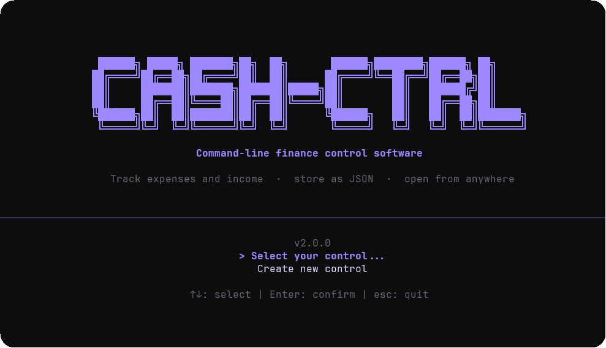
</p>

### Create new Control

Step-by-step form:
1. Control name (becomes the filename, e.g. `June-2026.json`)
2. Auto-preview of the save path
3. Starting balance (in BRL)

<p align="center">
  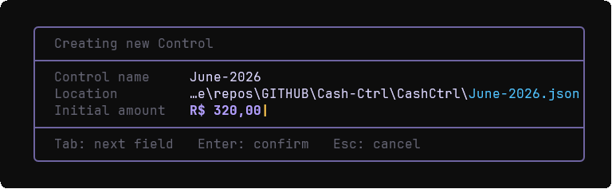
</p>

Before the control is created and opened, a **confirmation** screen shows the data you entered (name, file path and starting balance). Review them and:
- `Enter` — confirm and create the control
- `V` — preview the JSON that will be written
- `Esc` — cancel without creating anything

<p align="center">
  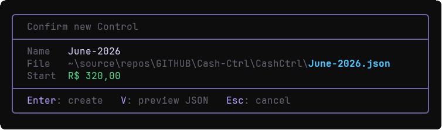
</p>

After confirming, the new control opens on the main screen. Since nothing was added yet, it is empty:

<p align="center">
  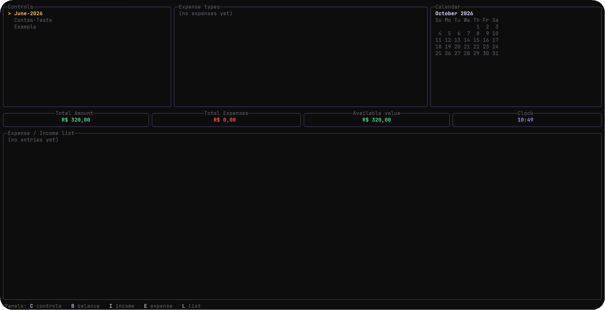
</p>

| Area | Description |
|---|---|
| **Controls** (top left) | Lists the controls found in the same directory. The open one is marked with `>` and highlighted. Focus with `C` |
| **Expense types** (top center) | Spending by category. Shows `(no expenses yet)` until the first expense is added |
| **Calendar** (top right) | Calendar of the current month. Days with entries are colored (red = expense, green = income, purple = both); empty for now |
| **Total Amount** | Starting balance plus incomes. Here it shows the initial amount set on creation (`R$ 320,00`) |
| **Total Expenses** | Sum of all expenses. `R$ 0,00` while there are none |
| **Available value** | Total Amount minus Total Expenses. Green when positive, red when negative |
| **Clock** | Current time |
| **Expense / Income list** | Every expense and income entry. Shows `(no entries yet)` until one is added |
| **Footer bar** | Shortcuts: `C` controls · `B` balance · `I` income · `E` expense · `L` list. Press `?` for all commands |

To start, press `E` to add an expense or `I` to add an income.

### Open Control

Choose **Open controls** on the welcome screen to list your latest controls. Select one of the controls you already created with `↑` / `↓` and press `Enter`. `Esc` goes back.

<p align="center">
  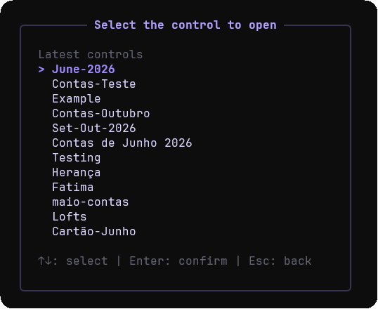
</p>

After selecting, a preview panel shows the control name, its value and the file path, with the options available for an existing control:

| Key | Action |
|---|---|
| `Enter` | Open the control on the main screen |
| `Delete` / `D` | Delete the control |
| `Esc` | Go back |

<p align="center">
  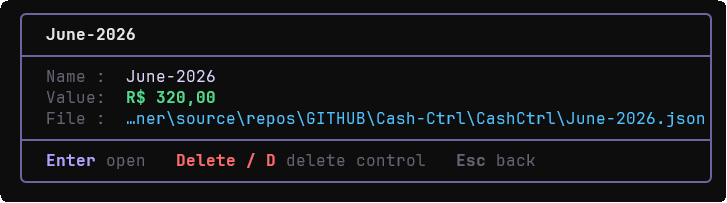
</p>

### Adding Expenses

To add a new expense, press `E` on the keyboard. The **New Expense** modal opens:

<p align="center">
  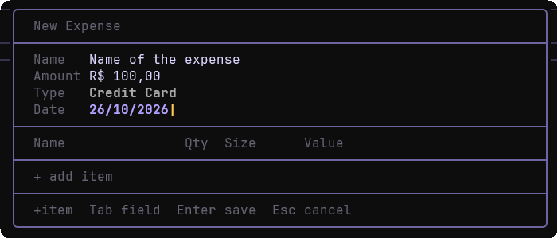
</p>

- Fields: **Name · Amount · Type · Date** (`Tab` moves to the next field)
- `Enter` saves, `Esc` cancels

If the expense is a shopping list, press `+` to add items. Each item has a name, quantity, size (`Kg` / `Un`) and a value. For `Kg` items the amount is calculated automatically from the per-item price:

<p align="center">
  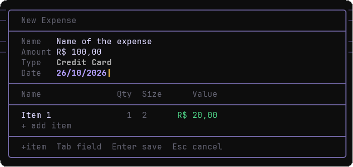
</p>

After saving, the expense shows up in several places of the main screen:

<p align="center">
  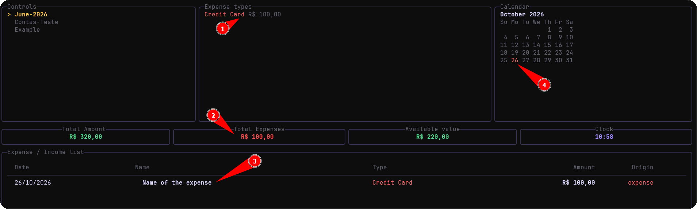
</p>

1. **Expense types** — the type of the expense (`Credit Card`) with the total spent in it (`R$ 100,00`), in the color chosen for that type
2. **Total Expenses** — the sum of all expenses; **Available value** is reduced by the same amount
3. **Expense / Income list** — the entry with its date, name, type, amount and origin (`expense`)
4. **Calendar** — the day of the expense is highlighted in red

### Calculator (`K`)

Floating panel on the top right. Type with the keyboard: digits, `.` or `,`, `+ - * / ^ %`, parentheses (`x` also multiplies).

<p align="center">
  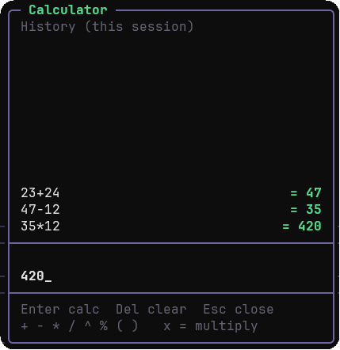
</p>

- `Enter` calculates; the result can be continued by typing an operator
- `Del` clears the current line, `Backspace` removes a character
- Keeps a **history of the current session**; it is cleared when the software is closed
- `Esc` closes the panel

### Help (`?`)

Floating panel listing every command for the main screen, entry list and calculator. Press any key to close.

<p align="center">
  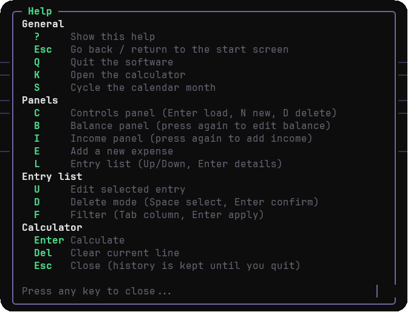
</p>

### Add Income

When you receive some amount, press `I` on the keyboard. The first press focuses the **Total Amount** panel; press `I` again to open the **Income** modal:

<p align="center">
  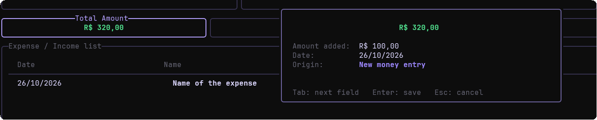
</p>

- The top shows the current **Total Amount**
- Fields: **Amount added · Date · Origin** (`Tab` moves to the next field)
- **Origin** is a title that explains where the income comes from (e.g. `New money entry`, `Salary`)
- `Enter` saves, `Esc` cancels

After saving, the income updates the main screen in these places:

<p align="center">
  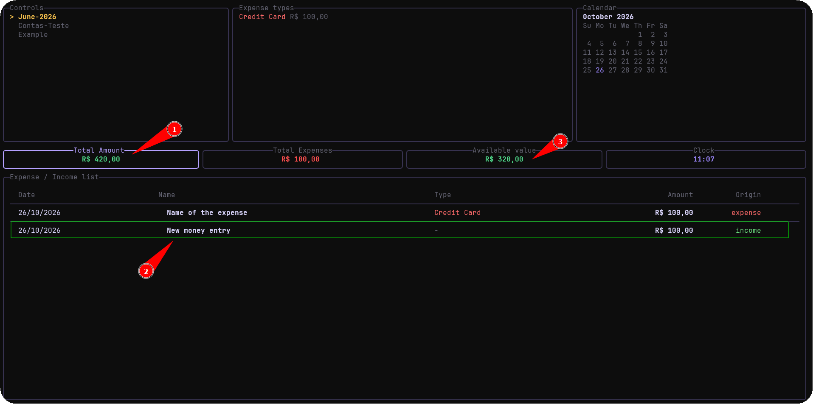
</p>

1. **Total Amount** — the income is added to the balance (`R$ 320,00` + `R$ 100,00` = `R$ 420,00`)
2. **Expense / Income list** — a new entry with the date, the origin title you typed (`New money entry`), the amount and the origin `income` (in green)
3. **Available value** — recalculated as Total Amount minus Total Expenses (`R$ 420,00` - `R$ 100,00` = `R$ 320,00`)

The day of the income is also highlighted in the **Calendar**: green for an income only, purple when the same day has both an expense and an income (as day `26` in the image).

### List of expenses and incomes

On the main screen of the control, press `L` on the keyboard to focus the **Expense / Income list**, which shows every money entry and exit of the control. The focused panel gets a highlighted border and the footer bar changes to the list commands:

<p align="center">
  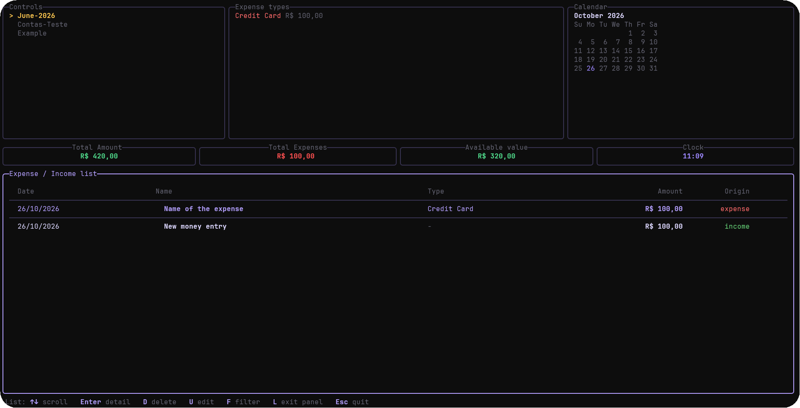
</p>

| Key | Action |
|---|---|
| `↑` / `↓` | Scroll through the entries |
| `Enter` | Open the details of the selected entry (line items of an expense) |
| `U` | Edit the selected entry |
| `D` | Delete mode: select entries with `Space` and confirm with `Enter` |
| `F` | Filter the list (`Tab` changes the column, `Enter` applies) |
| `L` | Exit the list focus |

Each row shows **Date · Name · Type · Amount · Origin**, where the origin is `expense` (red) or `income` (green).

### Edit Entry modal

With the list focused (`L`), use the `↑` / `↓` arrows to select the expense or income you want (1), then:

- `U` — edit the entry
- `D` — delete the entry (delete mode: `Space` marks, `Enter` confirms)
- `Enter` — see more details about the entry

Pressing `U` opens the **Edit entry** modal (2) with the data of the selected entry:

<p align="center">
  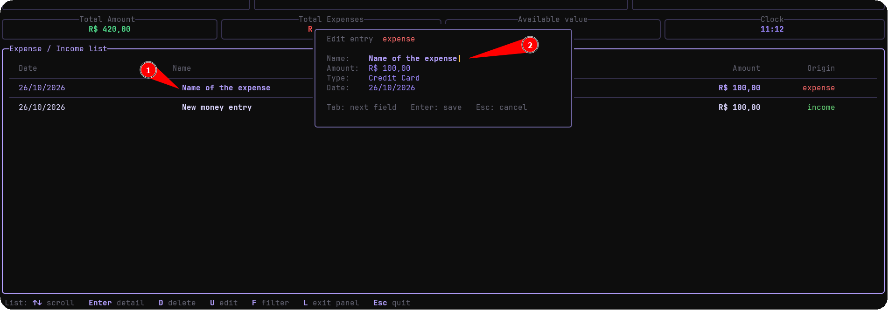
</p>

- Fields: **Name · Amount · Type · Date** (`Tab` moves to the next field)
- `Enter` saves, `Esc` cancels
- Changes take effect immediately and persist to the control file.

### Edit Total Balance (`B`)

To change the initial balance of the control, press `B` on the keyboard. The first press focuses the **Total Amount** panel (1); press `B` again to open the **balance** modal (2):

<p align="center">
  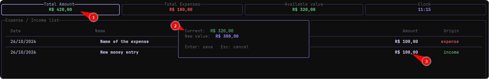
</p>

- **Current** shows the initial balance (`total-value`) of the current period, without the incomes
- Type the **New value** and press `Enter` to save, or `Esc` to cancel
- The change takes effect immediately and is saved in the control file

The value shown in **Total Amount** (1) is the **initial balance plus all the incomes** (3) of the control. In the image the initial balance is `R$ 320,00` and there is one income of `R$ 100,00`, so Total Amount is `R$ 420,00`. This is why the modal shows `R$ 320,00` as the current value and not `R$ 420,00`.

---

## Control file format

Controls are plain `.json` files stored wherever you create them.

- It's simple to verify and easier to store.

```json
{
  "name": "June-2026",
  "total-amount": 320,
  "Outubro 2026": {
    "total-value": 320,
    "expense-20261026105838": {
      "date": "26/10/2026",
      "total": 100,
      "type": "Credit Card",
      "type-color": "FF6B6B",
      "description": "Name of the expense",
      "origin": "expense",
      "details": [
        {
          "name": "Item 1 ",
          "amount": 20,
          "item-price": 0,
          "quantity": 1,
          "size": "2"
        }
      ]
    },
    "income-20261026110737": {
      "date": "26/10/2026",
      "total": 100,
      "type": null,
      "type-color": null,
      "description": "New money entry",
      "origin": "income",
      "details": []
    }
  }
}
```

| Field | Description |
|---|---|
| `name` (top level) | Control name |
| `total-amount` (top level) | Initial value set when the control was created; used as the starting balance of new periods |
| `total-value` | Starting balance for the period |
| `origin` | `"expense"` (money out) or `"income"` (money in) |
| `type` / `type-color` | Expense category and its chart color |
| `description` | Display name shown in the entry list |
| `details` | Line items (optional). Each item has `name`, `amount`, `quantity`, `size` (`Kg`/`Un`), and optionally `item-price` |

Favorites and recents are stored in: `%APPDATA%\CashCtrl\favorites.json`

Version info is cached in: `%APPDATA%\CashCtrl\version.json`

---

## Auto-update

Cash-Ctrl checks the [GitHub Releases](https://github.com/F4NT0/Cash-Ctrl/releases/latest) page in the background at startup and notifies you when a newer version is available. To update:

```powershell
cash-ctrl --update
```

This will download the latest `.exe` from GitHub and launch the installer automatically.

---

## Uninstall

To remove Cash-Ctrl from your machine:

```powershell
cash-ctrl --uninstall
```

This removes the executable and cleans up the PATH entry.

---

## Project structure

```
Cash-Ctrl/
├── CashCtrl.slnx
├── CashCtrl.Installer/
│   ├── CashCtrl.Installer.csproj
│   └── Program.cs                    ← Standalone Spectre.Console installer
├── CashCtrl/
│   ├── CashCtrl.csproj
│   ├── Program.cs                    ← CLI entry point & argument routing
│   ├── AppVersion.cs                 ← Current version constant
│   ├── Theme.cs                      ← Color palette & panel builders
│   ├── Fonts/
│   │   └── ansi-shadow.flf           ← Embedded figlet font
│   ├── Models/
│   │   ├── ControlFile.cs            ← Root data model
│   │   └── ControlEntry.cs           ← Expense / income entry + line items
│   ├── Services/
│   │   ├── ControlService.cs         ← JSON I/O, favorites, period helpers
│   │   └── VersionService.cs         ← GitHub release check & auto-update
│   └── Screens/
│       ├── WelcomeScreen.cs          ← Splash + main menu
│       ├── CreateControlScreen.cs    ← New control wizard
│       ├── NewControlModal.cs        ← Inline modal to create a control
│       ├── OpenControlScreen.cs      ← Open existing control
│       ├── MainScreen.cs             ← Full-screen finance dashboard
│       ├── NewExpenseModal.cs        ← Add expense with line items
│       ├── NewIncomeModal.cs         ← Add income
│       ├── EditEntryModal.cs         ← Edit an existing entry
│       ├── EditTotalModal.cs         ← Edit initial balance
│       ├── ExpenseDetailModal.cs     ← View expense line items
│       ├── CalculatorModal.cs        ← Floating calculator with session history
│       ├── HelpModal.cs              ← Floating help with all commands
│       └── InstallerScreen.cs        ← TUI installer & uninstaller (PATH setup)
├── dist/
│   └── cash-ctrl.exe                 ← Self-contained Windows executable
└── Docs/
    └── Details/
        └── Intro.md
```
